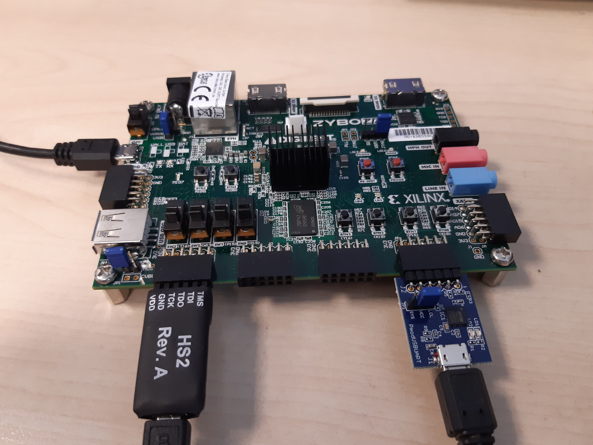
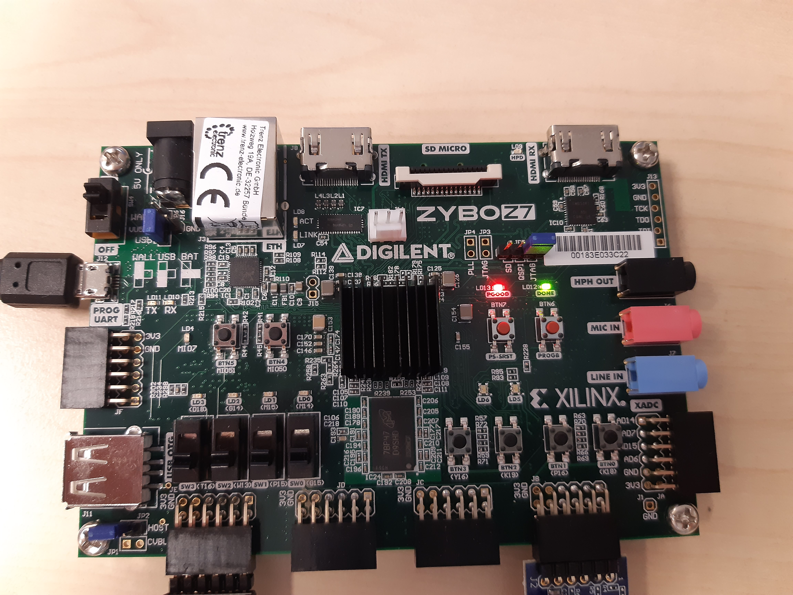
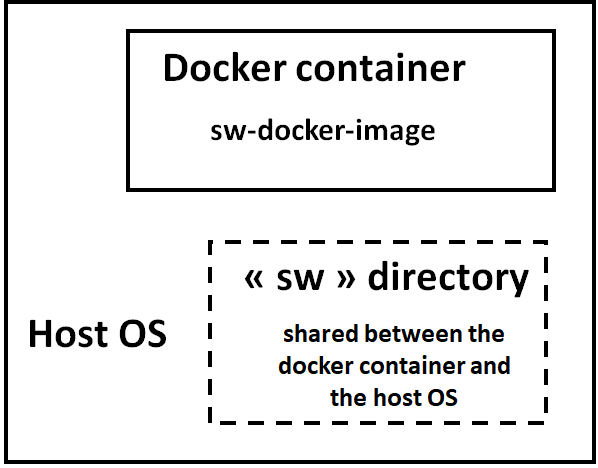

# Getting started

To get more familiar with CVA6 architecture, a partial documentation is available:

https://cva6.readthedocs.io/en/latest/

Checkout the repository and initialize all submodules:
```
git clone https://github.com/ThalesGroup/cva6-softcore-contest.git
git submodule update --init --recursive
```

Do not forget to check all the details of the contest in [Annonce RISC-V contest 2026-2027.pdf](./Annonce_RISC-V_contest_2026-2027_v1.0.pdf).

This repository contains the files needed for the 2026-2027 contest focusing on QOA audio encoding. The goal is to modify the CV32A6 architecture and/or add a coprocessor to accelerate the QOA encoder provided as an application written in C.

# Prerequisites


## Questa tool
Questa Prime **version 10.7** must be used to measure power during the simulations.
Other simulation tools and versions will receive no support from the organization team.

## Vitis/Vivado setting up
For the contest, the CVA6 processor will be implemented on Zybo Z7-20 board from Digilent. This board integrates a Zynq 7000 FPGA from Xilinx. 
To do so, **Vitis 2024.1** environment from Xilinx needs to be installed.

Furthermore, Digilent provides board files for each development board.

These files ease the creation of new projects with automated configuration of several complicated components such as Zynq Processing System and memory interfaces.

All guidelines to install **vitis 2024.1** and **Zybo Z7-20** board files are explained in
https://reference.digilentinc.com/reference/programmable-logic/guides/installation.

**Be careful about your linux distribution and the supported version of Vitis 2024.1 environment.**


## Hardware 
If you have not yet done so, start provisioning the following:

| Reference	                 | URL                                                                             |	List price |	Remark                            |
| :------------------------- | :------------------------------------------------------------------------------ | ---------: | :-------------------------------- |
| Zybo Z7-20	                | https://store.digilentinc.com/zybo-z7-zynq-7000-arm-fpga-soc-development-board/ |    $299.00	| Zybo Z7-10 is too small for CVA6. |
| Pmod USBUART               |	https://store.digilentinc.com/pmod-usbuart-usb-to-uart-interface/               |      $9.99 |	Used for the console output       |
| JTAG-HS2 Programming Cable |	https://store.digilentinc.com/jtag-hs2-programming-cable/                       |     $59.00	|                                   |
| Connectors                 |	https://store.digilentinc.com/pmod-cable-kit-2x6-pin-and-2x6-pin-to-dual-6-pin-pmod-splitter-cable/ | $5.99 |	At least a 6-pin connector Pmod is necessary; other references may offer it. |


# FPGA platform

A FPGA platform running **CV32A6** (CVA6 in 32 bits flavor) has been implemented on **Zybo Z7-20**

This platform includes a CV32A6 processor, a JTAG interface to run and debug software applications and a UART interface to display strings on hyperterminal.

The JTAG-HS2 programming cable is initially a cable that allows programming of Xilinx FPGAs (bitstream loading) from a host PC.

In our case, we use this cable to program software applications on the CV32A6 instantiated in the FPGA through a PMOD connector.

## Get the Zybo ready

1. First, make sure the Digilent **JTAG-HS2 debug adapter** is properly connected to the **PMOD JE** connector and that the USBAUART adapter is properly connected to the **PMOD JB** connector of the Zybo Z7-20 board.


2. Generate the bitstream of the FPGA platform:
```
make cva6_fpga
```

3. When the bitstream is generated, switch on Zybo board and run:
```
make program_cva6_fpga
```
When the bitstream is loaded, the green LED `done` lights up.



4. Get a hyperterminal configured on /dev/ttyUSBx 115200-8-N-1 LF mode

Now, the hardware is ready and the hyperterminal is connected to the UART output of the FPGA. We can now start the software.


**NOTE: The reset is mapped on the Y16 button near the PMOD, not on the RESET button.**

## Get started with software environment

This section describes how to build the software environment for the contest. To build any other application available in the **sw/app** folder, replace **qoa_encoder** with the name of the application folder : **qoa_encoder_1s**, **helloworld**, **coremark**...

**mnist** & **coremark** are used to make sure nothing is broken. But they are not the app we are interested in speeding up.

**The "qoa_encoder" and "qoa_encoder_1s" apps are the ones we are interested in for the contest. "qoa_encoder_1s" is provided to speed up simulations, it encodes a 1 second clip instead of 4 seconds. Only "qoa_encoder" is used for grading.**

### Building the docker image

Install Docker on the workstation.

A **sw-docker** docker container is used to ease the installation of RISC-V tools including the toolchain and OpenOCD.

1. The **sw-docker** image can be built using the following command:

```
docker build -f Dockerfile --build-arg UID=$(id -u) --build-arg GID=$(id -g) -t sw-docker:v1 .
```

### Using the docker image

the **sw-docker** Docker container consists of the entire RISC-V compilation chain as well as the openocd tool.

2. To compile software applications in **sw/app**, you need to use Docker container with the following command:

```
docker run -ti --privileged -v $XDG_RUNTIME_DIR/pulse/native:$XDG_RUNTIME_DIR/pulse/native -e PULSE_SERVER=unix:$XDG_RUNTIME_DIR/pulse/native -v $(realpath sw):/workdir sw-docker:v1
```

The **sw** directory is mounted in the docker container.

The PulseAudio socket of the host is also mounted in the container. It is used to play the audio encoded by **qoa_encoder**, see [Listen to the encoded audio](#listen-to-the-encoded-audio).


Once in the **sw-docker** Docker container, you are in the default directory **/workdir** which corresponds to the sw directory in the host OS.

```
user@[CONTAINER ID]:/workdir$ ll
total 24
drwxrwxr-x  5 user user 4096 Nov 23 10:57 ./
drwxr-xr-x  1 root root 4096 Nov 24 09:09 ../
-rw-rw-r--  1 user user 2620 Nov 23 10:57 README.md
drwxrwxr-x 18 user user 4096 Nov 23 10:59 app/
drwxrwxr-x  5 user user 4096 Nov 23 10:57 bsp/
drwxrwxr-x  2 user user 4096 Nov 23 10:57 utils/
```

3. To compile qoa_encoder application, run the following commands.
```
user@[CONTAINER ID]:/workdir$ cd app
user@[CONTAINER ID]:/workdir/app$ make qoa_encoder

```
At the end of the compilation the qoa_encoder.riscv executable file must be created.

4. Then, in the Docker container, launch **OpenOCD** in background:
```
user@[CONTAINER ID]:/workdir/app$ openocd -f openocd_digilent_hs2.cfg &
[1] 15
user@[CONTAINER ID]:/workdir/app$ Open On-Chip Debugger 0.12.0-g9ea7f3d (2026-10-29-20:20)
Licensed under GNU GPL v2
For bug reports, read
        http://openocd.org/doc/doxygen/bugs.html
Info : auto-selecting first available session transport "jtag". To override use 'transport select <transport>'.
Info : clock speed 1000 kHz
Info : JTAG tap: riscv.cpu tap/device found: 0x249511c3 (mfg: 0x0e1 (Wintec Industries), part: 0x4951, ver: 0x2)
Info : datacount=2 progbufsize=8
Info : Examined RISC-V core; found 1 harts
Info :  hart 0: XLEN=32, misa=0x40001100
Info : starting gdb server for riscv.cpu on 3333
Info : Listening on port 3333 for gdb connections
Ready for Remote Connections
Info : Listening on port 6666 for tcl connections
Info : Listening on port 4444 for telnet connections
```

5. In the Docker container (same terminal), launch **gdb** as following:
```
user@[CONTAINER ID]:/workdir/app$ riscv-none-elf-gdb -ex 'target extended-remote :3333' qoa_encoder.riscv
GNU gdb (GDB) 14.0.50.20230114-git
Copyright (C) 2022 Free Software Foundation, Inc.
License GPLv3+: GNU GPL version 3 or later <http://gnu.org/licenses/gpl.html>
This is free software: you are free to change and redistribute it.
There is NO WARRANTY, to the extent permitted by law.
Type "show copying" and "show warranty" for details.
This GDB was configured as "--host=x86_64-pc-linux-gnu --target=riscv-none-elf".
Type "show configuration" for configuration details.
For bug reporting instructions, please see:
<https://www.gnu.org/software/gdb/bugs/>.
Find the GDB manual and other documentation resources online at:
    <http://www.gnu.org/software/gdb/documentation/>.

For help, type "help".
Type "apropos word" to search for commands related to "word"...
Reading symbols from qoa_encoder.riscv...
Remote debugging using :3333
Info : accepting 'gdb' connection on tcp/3333
(gdb)
```

6. In **gdb**, load **qoa_encoder.riscv** to CV32A6 FPGA platform by the load command:
```
(gdb) load
Loading section .vectors, size 0x80 lma 0x80000000
Loading section .init, size 0x5c lma 0x80000080
Loading section .text, size 0xfc78 lma 0x800000e0
Loading section .rodata, size 0x2663c lma 0x8000fd58
Loading section .eh_frame, size 0x3c lma 0x80036394
Loading section .data, size 0x6cc lma 0x800363d0
Loading section .sdata, size 0x60 lma 0x80036aa0
Start address 0x80000080, load size 223992
Transfer rate: 64 KB/sec, 11199 bytes/write.
```

7. Finally, in **gdb**, you can run the **qoa_encoder** application with **the continue** command :
```
(gdb) c
Continuing.
(gdb) 
```

8. On the hyperterminal, you should see:
```
clip: 25920 bytes, 21663580 cycles, 16842126 instr, encode OK
SUCCESS: clip matches
```

This result is obtained right after the FPGA bitstream loading.
When qoa_encoder is rerun, system is not at initial state. For instance, cache is preloaded.


If the qoa_encoder failed, you would see:
```
clip: 25920 bytes, 21663580 cycles, 16842126 instr, encode FAIL
FAIL: result values incorrect
```

## Listen to the encoded audio

The qoa_encoder application only prints the size of the encoded stream. To listen to it, you can dump the **out** buffer from gdb and play it with **qoaplay**.

This is where the PulseAudio mount of the docker run command comes into play.

1. In **gdb**, set a breakpoint on **qoa_encode** and run the application:
```
(gdb) b qoa_encode
Breakpoint 1 at 0x80002390: file qoa_encoder/qoa.h, line 487.
(gdb) continue
Continuing.

Breakpoint 1, qoa_encode (sample_data=sample_data@entry=0x800167f8 <corpus>, 
    qoa=qoa@entry=0x8003fed4, out_len=out_len@entry=0x8003fed0) at qoa_encoder/qoa.h:487
487             if (
```

2. Run until the end of **qoa_encode** with the **finish** command, the encoded stream is returned in **$a0**:
```
(gdb) finish
Run till exit from #0  qoa_encode (sample_data=sample_data@entry=0x800167f8 <corpus>, 
    qoa=qoa@entry=0x8003fed4, out_len=out_len@entry=0x8003fed0) at qoa_encoder/qoa.h:487
0x80000148 in main () at qoa_encoder/main.c:32
32              uint8_t *out = qoa_encode(corpus, &qoa, &len);
Value returned is $1 = (void *) 0x80036e18
```

The dump must be done right after **finish**, before any other command that overwrites **$a0**.

3. Store the address of the stream in a variable and dump **len** bytes to a file:
```
(gdb) set $p = (char *)$a0 
(gdb) dump binary memory out.qoa $p $p+len
```

4. Play the file from gdb with **qoaplay**. You do not need to quit gdb to run terminal commands, prefix them with **!**:
```
(gdb) !qoaplay out.qoa 
out.qoa: channels: 1, samplerate: 16000 hz, samples per channel: 64000, duration: 4 sec
Controls: [x] rewind / [c] skip / [q] quit
   2.30 / 4.00 sec
(gdb) 
```

You can also play the file outside gdb:
```
user@[CONTAINER ID]:/workdir/app$ qoaplay out.qoa
```

The **app** directory is mounted in the container, so **out.qoa** is also available on your host machine. **qoaplay** is not installed there by default. If you want to play the file outside the docker container, you can build **qoaplay** from the qoa repository, using commit **f73b4a3**:
```
git clone https://github.com/phoboslab/qoa
cd qoa
git checkout f73b4a3
curl -fsSL https://raw.githubusercontent.com/floooh/sokol/6f5f4b0/sokol_audio.h -o sokol_audio.h
make CFLAGS_PLAY="-std=gnu99 -O3 -include unistd.h"
```

The **make** command builds both **qoaplay** and **qoaconv**.

**qoaconv** converts QOA files to another format, it allows you to convert **out.qoa** to a **wav** file for instance:
```
user@[CONTAINER ID]:/workdir/app$ qoaconv out.qoa out.wav
out.qoa: channels: 1, samplerate: 16000 hz, samples per channel: 64000, duration: 4 sec (took 0.00 seconds)
out.wav: size: 125 kb (128036 bytes) = 250.07 kbit/s, psnr: inf db (took 0.00 seconds)
```

**qoaconv** is built without the MP3 and FLAC decoders in the **sw-docker** image, only **wav** and **qoa** are supported.

# Simulation get started
When the development environment is set up, it is now possible to run a simulation.
Some software applications are available into the **sw/app** directory. Especially, there are benchmark and test applications such as CoreMark, MNIST and hello world.

To simulate a software application on CVA6 processor, run the following command:
```
make sim APP=’application to run’
```
For instance, if you want to run the **qoa_encoder_1s** application, you will have to run :
```
make sim APP=qoa_encoder_1s
```

**This command:**
- Compiles CVA6 architecture and testbench with Questa Sim tool.
- Compiles the software application to be run on CVA6 with RISCV tool chain.
- Runs the simulation.

Questa tool will open with waveform window. Some signals will be displayed; you are free to add as many signals as you want.

Moreover, all `printf` used in software application will be displayed into the **transcript** window of Questa Sim and save into **uart** file to the root directory.

> Simulation may take a lot of time, you need to be patient to have results.

Simulation is programmed to run 1000000000 cycles but the result is displayed before the end of simulation.

CVA6 software environment is detailed into `sw/app` directory.

# Synthesis and place and route get started
You can perform synthesis and place and route of the CVA6 architecture.

In the first time, synthesis and place and route are carried in "out of context" mode, that means that the CVA6 architecture is synthetized in the FPGA fabric without consideration of the external IOs constraints.

That allows to have an estimation of the logical resources used by the CVA6 in the FPGA fabric as well as the maximal frequency of CVA6 architecture. They are both major metrics for a computation architecture.

Command to run synthesis and place & route in "out of context" mode:
```
make cva6_ooc CLK_PERIOD_NS=<period of the architecture in ns>
```
For example, if you want to clock the architecture to 50 MHz, you have to run:
```
make cva6_ooc CLK_PERIOD_NS=20
```
By default, synthesis is performed in batch mode, however it is possible to run this command using Vivado GUI:
```
make cva6_ooc CLK_PERIOD_NS=20 BATCH_MODE=0
```
This command generates synthesis and place and route reports in **corev_apu/fpga/reports_cva6_ooc_synth** and **corev_apu/fpga/reports_cva6_ooc_impl**.

